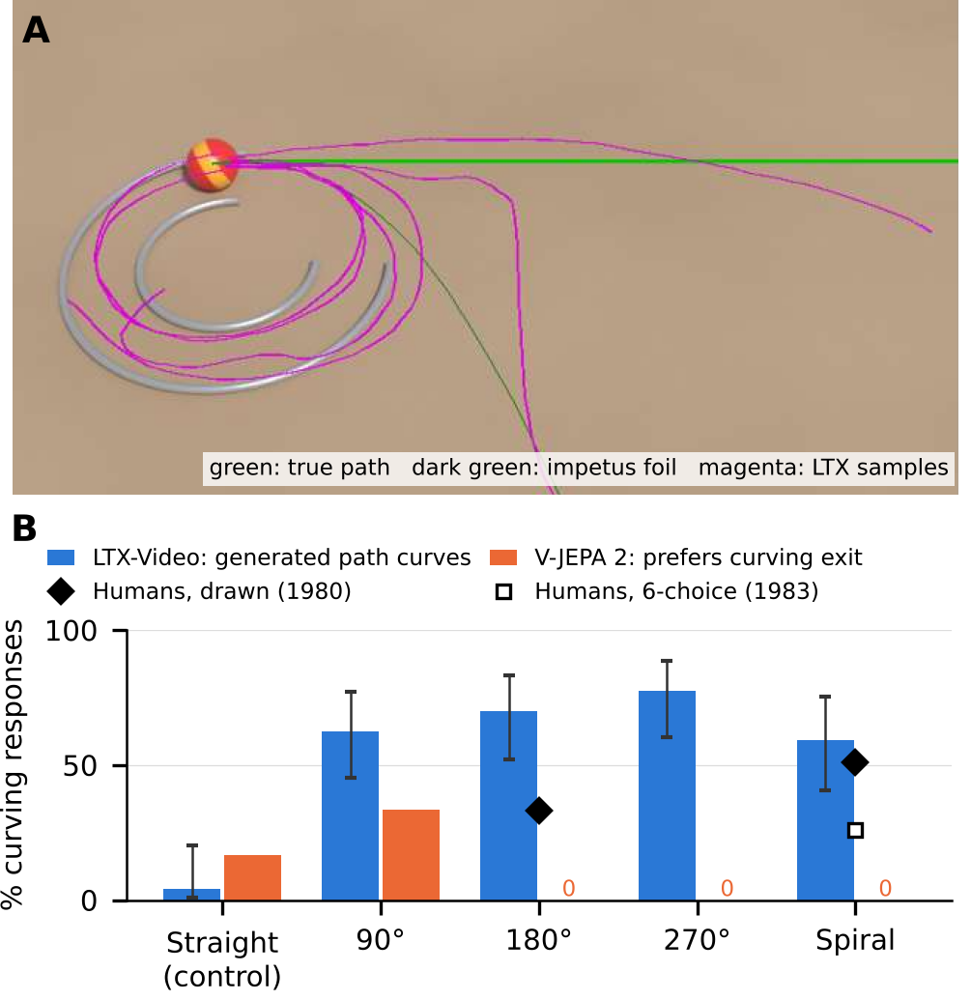

# AI Psychophysics: do video models make human-like physics errors?

Ask people where a ball goes after it shoots out of a curved tube, and many say it **keeps curving**, although physics says it goes straight. This "curvilinear impetus" error is one of the best-known misconceptions in intuitive physics (McCloskey, Caramazza & Green, 1980).

AI video models are now used as learned simulators of the physical world, but they are scored on whether they are right, not on *how* they are wrong. This project runs classic naive-physics paradigms on video generators and world models with the **same stimuli** used for humans, and asks whether their errors look like ours.



*(A) Six LTX-Video continuations (magenta) of one 270° tube: most keep following the arc, while the true path (green) is straight. (B) Share of "keeps curving" responses by tube shape for the video generator (blue, 95% CIs), the world model (orange) and published human data (black).*

## Main result so far

| Model | Task | Curved tubes | Straight tube (control) |
|---|---|---|---|
| **LTX-Video 0.9.5** (2B, video generator) | Continue the clip | **68% keep curving** (81 / 120 valid clips) | 4% (1 / 24) |
| **V-JEPA 2** (ViT-L, world model) | Which ending is less surprising? | 8% prefer curving (2 / 24 items) | 1 / 6 |
| Humans (McCloskey et al. 1980; McCloskey & Kohl 1983) | Draw / choose the path | 33% (C-tube) to 51% (spiral) drawn; 26% chosen | |

- The **generator reproduces, and exceeds, the human error**: it curves on every tube shape (59 to 77%) and at both speeds, but almost never after a straight tube (Fisher exact, one-sided, p ≈ 4 × 10⁻⁹).
- The **world model does not**: judging two endings, it finds the curving one *more* surprising. So the same input yields a human-like error when a model must *generate* the future but not when it *evaluates* it, echoing the human gap between predicting a path and judging a moving display.

Full numbers: [`experiments/pilot/v2/results_all/README.md`](experiments/pilot/v2/results_all/README.md). Write-up: CCN extended-abstract draft in [`docs/ccn-abstract/`](docs/ccn-abstract/).

## Method in one minute

1. **Stimuli.** A red ball rolls through a tube on a table: straight (control), 90°, 180°, 270° arcs and a 1.1-turn spiral, × 2 speeds × 3 layouts = 30 items. Exact 2D physics from [`stimgen/`](stimgen/), re-rendered realistically in Blender ([`stimuli/A1_3d/`](stimuli/A1_3d/)). Every model input stops one frame **before** the ball leaves the tube, so nothing after the exit is shown.
2. **Generation readout.** The video model continues the clip; we track the ball and compare the heading of its late path with the exit tangent. A turn of more than 5° towards the tube's bend is *curving*, more than 5° the other way *outward*, otherwise *straight*. Rules were fixed before any output was seen; clips where the ball vanishes, freezes or duplicates, or the tube deforms, are excluded and reported.
3. **Evaluation readout.** The world model sees the context and two futures (true straight exit vs a curving foil); it "prefers curving" when the foil is less surprising (prediction error on the ball's patches).
4. **Humans.** Browser experiments replicate McCloskey & Kohl (1983) with our exact spiral tube, plus a draw-the-path / which-looks-natural task on all 30 items, scored with the same classifier as the models.

## Models

| Model | Type | Where it ran | Status |
|---|---|---|---|
| LTX-Video 0.9.5 (2B) | open video generator | Kaggle, 2 × T4 | ✅ done (2D and 3D stimuli) |
| V-JEPA 2 (ViT-L) | open world model | Kaggle | ✅ done |
| Wan 2.2 I2V (A14B) | open video generator | RunPod A100/H100 | 🟡 script ready ([`experiments/runpod-wan/`](experiments/runpod-wan/)) |
| Seedance (via fal.ai) | closed video generator | Kaggle notebook + API | 🟡 notebooks ready ([`experiments/pilot/v2/`](experiments/pilot/v2/)) |
| Veo 3.1, Gemini image editing | closed | by hand | 🟡 prompts and frames ready ([`experiments/image-model-prompts/`](experiments/image-model-prompts/)) |
| Humans | browser experiment | lab | 🟡 experiment built and tested, data collection next |

## Repository layout

```
docs/                     research plan, literature, human baselines, study deck, CCN abstract draft
  ideas/                  the three initial research briefs
stimgen/                  stimulus generator (exact 2D physics + Blender 3D render), demo set
stimuli/A1_3d/            the 30 realistic tube items (context clip, still, true and curving futures)
experiments/
  slide21_kaggle.ipynb    first run: LTX-Video + V-JEPA 2 on the 2D items (Kaggle)
  analyze.py              ball tracker and pre-registered curving classifier
  inputs/                 2D model inputs for that run
  results-kaggle-run1/    its results
  pilot/v2/               3D re-render, full LTX run, V-JEPA probe, Seedance/fal.ai notebooks, results
  runpod-wan/             Wan 2.2 on RunPod
  image-model-prompts/    frames and prompts for Gemini / Veo
  human/                  browser experiments for participants + scoring
```

## Reproduce

**Stimuli** (CPU, any computer):
```bash
pip install -r stimgen/requirements.txt
python stimgen/stimgen.py --families A1 --out stimuli_2d   # 30 tube items, ~1 min
```
The 3D render (`stimgen/make3d.py`, `stimgen/render3d.py`) needs Blender; see [`stimgen/README.md`](stimgen/README.md).

**LTX-Video + V-JEPA 2 on Kaggle (free T4):** follow [`experiments/README.md`](experiments/README.md).

**Wan 2.2 on RunPod:**
```bash
git clone https://github.com/imerej/AI_psychophysics_curvilinearimpetus.git
cd AI_psychophysics_curvilinearimpetus/experiments/runpod-wan
pip install -q -U -r requirements.txt
python run_wan.py --test && python run_wan.py
```

**Human experiment:** open `experiments/human/experiment.html` in a browser (no install, English or French). Score with `python experiments/human/score_mk.py`.

API keys (fal.ai for Seedance) are read from Kaggle secrets at run time; none are stored in this repository.

## Next steps
- Run Wan 2.2, Seedance and Veo on the same items, and test humans on the rendered stimuli.
- Score the generator's own likelihood of each exit (generate vs evaluate within one model).
- Extend to other classic errors: dropping an object from a moving carrier, the cut pendulum, the snapped string ([`docs/paper-plan.md`](docs/paper-plan.md)).

## Authors
Jérémie Robin and Han Sem Sohn, AI Psychophysics, Sungkyunkwan University.

## Key references
- McCloskey, Caramazza & Green (1980). Curvilinear motion in the absence of external forces. *Science*, 210, 1139–1141.
- McCloskey & Kohl (1983). Naive physics: the curvilinear impetus principle. *JEP: LMC*, 9, 146–156.
- Kaiser, Proffitt & Anderson (1985). Judgments of natural and anomalous trajectories. *JEP: LMC*, 11, 795–803.
- Assran et al. (2025). V-JEPA 2. arXiv:2506.09985. HaCohen et al. (2024). LTX-Video. arXiv:2501.00103.
