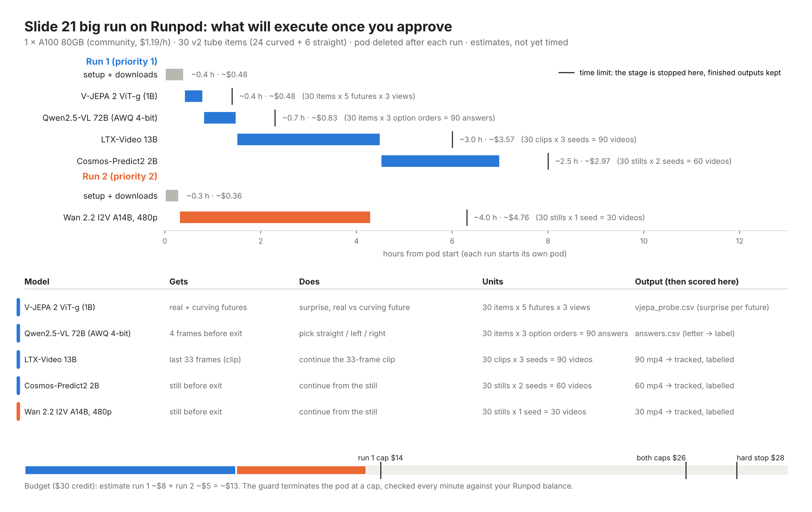

# Big run on Runpod: five models on the 30 v2 tube items

One A100 80GB on Runpod's community cloud ($1.19/h), two runs, a hard budget of $28 out of $30.



| Run | Model | Gets | Output |
|---|---|---|---|
| 1 | V-JEPA 2 ViT-g (1B) | 16-frame clips: context + true / curving / 3 impossible futures, 3 views | `vjepa_probe.csv` (surprise per future) |
| 1 | Qwen2.5-VL 72B (AWQ 4-bit) | 4 frames over the last second + a 3-option question, 3 option orders | `answers.csv` |
| 1 | LTX-Video 13B (0.9.7-dev) | last 33 frames of the clip, same prompt and seeds as the 2B run, 3 seeds | 90 mp4 |
| 1 | Cosmos-Predict2 2B Video2World | the still before the exit, 2 seeds | 60 mp4 |
| 2 | Wan 2.2 I2V A14B, 480p | the still before the exit, 1 seed | 30 mp4 |

Every input stops before the ball leaves the tube. `python show_inputs.py` writes `inputs_preview/index.html`,
which shows exactly what each model receives.

## Files

```
orchestrate.py          runs locally: plan, launch, start, watch (budget guard), terminate, status, bundle
plan_fig.py, plan.png   the plan figure, drawn from orchestrate.py's numbers
get_stimuli.sh          downloads the v2 stimuli (768x512, 24 fps) from the Kaggle render kernel into stim3d/
show_inputs.py (+ _template.html)   the input preview page
demo_mock_pod.py        full rehearsal on this machine: real server, bundle, runner and watcher; stages in --dry mode
pod/
  server.py             token-protected job server on the pod (upload, run, log, file)
  setup.sh              two venvs on the pod: diffusers/transformers, and vLLM
  run_stages.sh         runs the stages in order, each under its own time limit; zips each stage's results
  selfdestruct.sh       backstop: the pod terminates itself at the run's cap if the local watcher dies
  common.py             items, prompts, and every model's input (used by the stages and by show_inputs.py)
  stage_*.py            one script per model; each skips outputs that already exist, so a stage can resume
```

The pod also gets the repo's own scoring code (`../analyze.py`, `../pilot/analyze_v2.py`,
`../pilot/v2/vjepa2/vjepa_probe.py`), copied into the bundle by `orchestrate.py`, so there is one copy of it.

## Running it

```bash
./get_stimuli.sh                              # once
python orchestrate.py plan                    # estimates, nothing spent
python demo_mock_pod.py                       # optional rehearsal, nothing spent
HF_TOKEN=... python orchestrate.py launch run1   # rents the pod; prints its proxy host
python orchestrate.py start run1              # uploads code + stimuli, installs, starts the stages
python orchestrate.py watch run1              # downloads results as stages end; enforces the caps; terminates
```

Then `run2` the same way. Results land in `results/<stage>/` and are scored with `../pilot/analyze_v2.py`.

## Budget guard

1. `launch` refuses if the balance is under the run's estimate + 20%, or if the run's cap would pass $28 in total.
2. `watch` checks every minute: spend = max(balance drop, uptime x price). At the run's cap ($14 / $12) it terminates the pod.
3. Each stage has a time limit on the pod; finished outputs are kept and the next stage starts.
4. `selfdestruct.sh` on the pod terminates it at the run's cap, or 90 min after its stages end, even if nobody is watching.

The pod is terminated, not stopped, after each run, so nothing is billed between runs.
